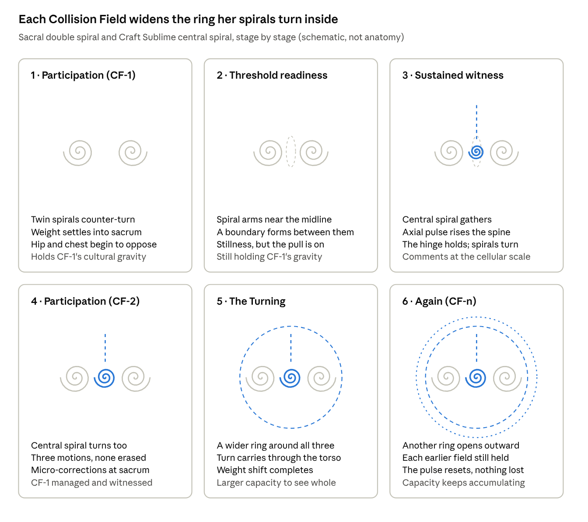

# SVARA — DOMAIN: THE TURNING

**Status:** CHARACTER DOMAIN, PROPOSED / WORKING. Deposited at Bart's direction ("drop it in the repo"), 2026-10-19. Supersedes the earlier same-day version of this file. "The Turning, as Bart defines it" is Bart's authoritative account; the extension (The Turning of Consciousness, Rishi–Signal–Capacity, Microscopic Turning, Witness–Participation Fold) is a proposed hypothesis, not canon and not certified as a Collision Field. Open decisions are listed at the end.
**Date:** 2026-10-19
**Authority:** Bart's definition of the Turning (2026-10-19); Bart's ChatGPT session deposited verbatim as `SVARA_TURNING_OF_CONSCIOUSNESS_SOURCE_2026-10-19.md`; Svara's existing sources (Oct 12 Two Turnings; Oct 15 intake and gravity custody; Oct 16 tattoo map and draft 01 record; sevenfold score; Embodied Geography). Fundamental rule: activation through her tattoo (sacral double spiral). The poem *THE TURNING* was written by Claude; *The Sound That Heard Its Turning* and *The Microscopic Return* are from Bart's session.
**Read with:** `CRAFT_SUBLIME_TATTOO_CHARACTER_MAP_2026-10-16.md` §3, `IMAGES/CRAFT_SUBLIME/SVARA_TATTOO_DRAFT_01_RECORD.md`, `../../DOUBLE_COLLISION_FIELD_PAGE_THAT_WAITED/01_SVARA_CHARACTER_INTAKE_AND_GRAVITY_CUSTODY.md`, `GRAPHIC_CHARACTER_CONTINUITY_PROTOCOL.md`.
**Diagram:** `IMAGES/DOMAINS/SVARA_TURNING_STAGES_DIAGRAM.png` (schematic rendering of the doc's live diagram; not a tattoo design or character image).
**Live editable copy:** https://claude.ai/code/artifact/ce0b0a65-1b8a-4e74-951c-59a52b592d94

## At a glance

|  |  |
| --- | --- |
| **Who** | Svara: a fictional performer and maker of **the Turning**, and the one who can *watch the performance while performing it*. Met by Him on Oct 12 in a studio of shoji-like panels, vessels, wires, metal tongues, water droplets and a turning column. |
| **Office** | **Custodian of gravity relations**: attractors, resisted motions, convergence, divergence, recurrence and possible new third relations. She attends to gravity; she never decides for anyone. |
| **Domain (proposed)** | **The Turning**: how attraction organizes two distinct motions into a shared rotation, and how a centre appears between them that neither owns and neither is erased by. |
| **Tattoo** | Ancient **double spiral** becoming Craft Sublime's **central spiral** (GRAVITY, resonance, rhythmic Turning), at the **lower sacrum / upper gluteal junction**. Process office: **Recognition / Adhesion / Attunement**. |
| **Activation site** | The sacral double spiral. The Turning begins in her lower back and sacrum and moves out through weight shift and rotation. |
| **Look** | `SVARA_PRIMARY.png`: green-hazel eyes with a pale inner ring, freckles over nose and cheeks, wet dark-brown hair, full lips, sun-warm skin. |
| **Her Returns** | THE OPENING MUST SURVIVE WHAT ENTERS IT. · WHAT ENTERS MAY CHANGE WHERE AN OPENING CAN EXIST. |
| **Her name** | *Svara*: in Sanskrit and Indian music, a note or tone. Her meeting with Him's "Bhakti" disclosed *svarabhakti*, the real linguistic term for a vowel inserted between consonants. |

This page builds Svara's domain the way Rox has The Thrum and Amara has the Izibongo: a mapped process from the real world, a poetic voice, and an activation that begins at her tattoo. It is a proposal for Bart to shape, not yet canon.

## Her domain: The Turning

The Turning is already Svara's named talent: what Him promised she would show Amara. As a domain it becomes the territory her gravity custody works in.

**Working definition.** *The Turning is the motion by which two distinct movements, drawn by a shared gravity, begin to turn around a centre that neither of them occupies. The centre is real, it organizes them both, and it exists only because both keep moving.*

Three things make it hers:

- **Two, then a centre.** Her tattoo says it: the ancient double spiral produces the central spiral, and "its two recognizable movements remain audible in the one." The centre arises out of their interaction, not by erasing either twin.
- **Gravity without decree.** She stewards attraction, not outcome. She can feel where things are pulled, what resists, what converges, what recurs. She does not decide for the participants, and gravity is never consent.
- **The witness inside the turn.** Her unique capacity is to take part in the Turning while watching it happen. She is inside the rotation and can still see its shape.

**How it sits beside the others.** Rox's Thrum is the live activity *at a threshold* between possibility and relation. Amara's Izibongo is the *voice* that carries memory into relationship. Svara's Turning is the *gravity* that brings two motions into a shared rotation before any threshold is crossed. In the sevenfold score she is Recognition / Adhesion: surfaces drawn together and attuned, not yet joined.

**Her two Returns are the domain's first laws.** *The opening must survive what enters it.* *What enters may change where an opening can exist.* And the deeper compression from her second Turning: **a threshold may survive not by preserving its form, but by retaining the capacity to form another opening.** In her second Turning she removed one supporting finger and the opening moved. A small withdrawal can redirect the whole field.

## The Turning, as Bart defines it (Oct 19)

*This is the authoritative account of how the Turning works. Everything else on this page serves it.*

Svara **participates and perceives** in a Collision Field while **managing its cultural gravity**. When that field's boundary / threshold is ready for a **second Collision Field**, she has a **sustained moment of witness** as the second field's boundary / threshold builds. She can **comment on it at a cellular, microscopic level**, while still **actively managing the cultural gravity of the first field**.

She then **participates in the activity of the second Collision Field**, in a microscopic, cellular way, and has the capacity, **while still managing the first field, to see it as a witness**.

**That is the Turning:** when the second Collision Field happens, it gives her a **larger capacity to perceive the whole**.

**It doesn't stop at two.** Multiple Collision Fields can happen, and with each one she **continues to gain capacity**.

### The sequence

| Stage | What Svara is doing | What she holds at the same time |
| --- | --- | --- |
| **1. Participation (CF-1)** | Participates in and perceives the first field | Manages CF-1's cultural gravity |
| **2. Threshold readiness** | Recognizes that CF-1's boundary / threshold is ready for a second field | Still managing CF-1's gravity |
| **3. The sustained witness** | Witnesses CF-2's boundary / threshold as it builds, and **comments on it microscopically** (apposition, recognition, adhesion, hemifusion, pore) | Still managing CF-1's gravity |
| **4. Participation (CF-2)** | Enters CF-2's activity at the cellular / microscopic scale | Manages CF-1 **and** witnesses it |
| **5. The Turning** | CF-2 happens; her capacity to perceive the whole enlarges | Both fields held, neither collapsed into the other |
| **6. Again (CF-n)** | A further field's threshold builds; the cycle repeats | Every earlier field still managed and witnessed |

### Three tracks running at once

1. **Gravity custody:** she keeps managing the cultural gravity of every field already in play. She never drops the earlier field to attend to the new one.
2. **Microscopic witness:** she comments on the new boundary as it forms, at the cellular level, using the stages of the *Microscopic Turning* (below). Her office is recognition and adhesion, so she describes the boundary's readiness; she does not force fusion.
3. **Participation:** she is inside the activity of the newest field, at the scale of surfaces, contact and passage.

### Capacity accumulates

| Fields in play | Capacity gained |
| --- | --- |
| CF-1 | Participate and perceive, while managing gravity |
| CF-2 | Participate in CF-2 while witnessing CF-1 as a whole |
| CF-3 | Participate in CF-3 while witnessing CF-1 and CF-2 and the relation between them |
| CF-n | Perceive a larger whole: every earlier field, and how each changed the next |

Each Turning leaves a wider field of perception that persists into the next. This is her version of the *Sustained Reflexive Fold* and the progressive capacity described in the extension below: the witness doesn't leave the activity to see it, and what she witnesses changes how the next field can unfold.

### How her microscopic commentary reads

Short, precise, in the present tense, from inside the boundary, and marked as **fictional perceptual rendering**:

> *The surfaces are close now. Not touching. Something is recognizing something.* · *They're adhering. Outer layers only. The interiors are still their own.* · *There's a pore. It might close. Don't push it.*

All while the first field's gravity is still in her hands.

### The Turning on her body: the tattoo, stage by stage

Grey: the **ancient double spiral**, two spiral centres spanning the lower sacrum and upper gluteal contours. Accent: the **Craft Sublime additions**, the central spiral that arises between them, the restrained axial pulse up the sacral midline, and (new here) the widening rings that stand for each gain in capacity. Dashed oval: the forming boundary of the next Collision Field.

**Where it lives on her body.** Low on her back: the two spiral centres sit across the **lower sacrum and upper gluteal junction** (lowered per your Oct 16 correction), with the central spiral at the **sacral midline** between them and a short axial cadence rising up the midline above. Everything below is weight, rotation, balance and the hinge of the spine, never explicit.

| Stage | Ancient double spiral | Craft Sublime addition | How her body reacts | Microscopic layer |
| --- | --- | --- | --- | --- |
| **1. Participation (CF-1)** | Both spirals turn, counter to each other, distinct and complete | Central spiral not yet present | Weight drops into the sacrum. Pelvis and chest begin their ordinary counter-turn. Her hands are on CF-1's gravity | Two surfaces held apart; recognition not yet begun |
| **2. Threshold readiness** | The spirals' outer arms draw toward the midline without touching | A boundary forms at the midline (the next field's threshold) | Stillness at the hinge, but not rest: the pull is felt low in the back. She keeps managing CF-1 | **Apposition:** two membranes approach; interiors separate |
| **3. Sustained witness** | Both spirals keep turning; nothing stops | The **central spiral gathers** at the sacral midline; the **axial pulse** rises up the spine | The sacrum holds steady as a still point while the turns continue around it. Breath stays even. She comments from inside the boundary as it builds | **Recognition / adhesion**, perhaps **hemifusion**: outer layers meet, interiors still their own. This is her office; she describes, doesn't push |
| **4. Participation (CF-2)** | The twin spirals stay turning: CF-1's motion is not given up | The central spiral now **turns in its own right**: three motions, none erased | Small rotational corrections at the sacrum; hip and chest oppose more fully. She is inside CF-2 and still holding CF-1 | A **pore** may open and may close. She lets the boundary decide |
| **5. The Turning** | The twins and the centre turn together inside something larger | A **wider ring** forms around all three (the new capacity to perceive the whole) | The counter-turn carries up through the whole torso; the weight shift completes. The movement is bigger than the hips now | Not fusion: a new organization of distinct parts, like neurons coordinating without merging |
| **6. Again (CF-n)** | Unchanged at the core, still two | **Another ring** opens outward; the axial pulse resets without erasing the last | The sacrum settles again; each earlier field is still held in the body's balance | Each new boundary is met fresh; every earlier one keeps its form |

**Rules for writing it**

- **The twins never merge.** In every stage the two ancient spirals remain distinguishable. The central spiral arises *between* them; it never covers them (your map's warning against "a single arbitrary swirl covering the double motif").
- **The still point is the witness.** In stage 3 the sacral midline holds steady while everything turns around it. That stillness inside motion is the sustained moment of witness, in her body.
- **The rings are capacity, not ink.** The widening rings are how this page draws her growing perception; they are not proposed as new tattoo linework unless you decide they should be.
- **Gravity custody runs through every stage.** Whatever her spirals are doing, her hands stay on the cultural gravity of each field already in play.
- **Microscopic commentary is fiction.** Her cellular-scale lines are fictional perceptual rendering, built on the real stages (apposition, adhesion, hemifusion, pore) but never presented as observation.

## The mapped process: the Turning in physical reality

These are analogies and possible mechanisms, not proof of one universal process called the Turning. Each shows a different side of it.

### I. The barycenter: a centre neither body occupies

Two bodies bound by gravity don't orbit each other so much as both orbit their **shared centre of mass**. For Earth and Moon that point lies inside Earth. For Pluto and its large moon Charon it lies in the empty space *between* them, so both swing around a centre that neither one contains.

*The Turning here:* the centre is real and organizes both motions, yet it belongs to neither. Take either body away and the centre is gone.

### II. The sunflower: two families of spirals, winding opposite ways

The seeds in a sunflower head sit at a near-constant turning angle from one another. The eye reads the result as **two sets of spirals winding in opposite directions**, and their counts are usually consecutive Fibonacci numbers, such as 34 one way and 55 the other. Neither family is the "real" spiral; the pattern is both at once.

*The Turning here:* a double spiral that is one growth, counter-turning without contradiction. The image Svara wears.

### III. The walking body: pelvis and chest turn against each other

In ordinary walking the pelvis and the thorax rotate in the transverse plane, and at normal speeds they turn **largely out of phase**: as the pelvis turns one way, the chest turns the other, with the spine between them. As walking speeds up, their coordination shifts. That counter-rotation keeps the body balanced and moving forward.

*The Turning here:* her activation site is literal. The sacrum is the hinge where the lower turn meets the upper one, and every step is a small Turning.

### IV. The drone: gravity in sound

In Hindustani classical music the tanpura sustains the tonic, **Sa**, usually with Pa or another note, and every *svara* in the raga is heard in relation to that drone. Notes lean toward it, glide away and resolve back. The drone doesn't play the melody; it is the centre the melody turns around.

*The Turning here:* tonal gravity. It is also her name. A note is only itself in relation to the centre it keeps turning around.

### V. Two vortices: the critical distance

Two vortices spinning the same way will circle each other. Fluid dynamicists have found that if they come closer than a **critical merger distance**, they merge into one; farther apart, they keep orbiting as two.

*The Turning here:* the warning in her domain. Attraction past a certain point erases the twins into one swirl. Her custody keeps the turn alive *without* compulsory fusion, the very thing her tattoo map forbids: "a single arbitrary swirl covering the double motif."

### VI. The spiral galaxy: a pattern that outlasts its members

In density-wave theory, a spiral galaxy's arms are not fixed rivers of stars. They are waves of higher density, and stars and gas move **through** them, slowing and crowding in the arm, then moving on. The spiral persists while the things that make it change.

*The Turning here:* gravity can hold a shape that no single participant holds. Svara keeps the shape while letting what passes through it pass.

| Occurrence | Where the turn lives | What it reveals |
| --- | --- | --- |
| Barycenter | In the empty centre between two bodies | A centre neither owns |
| Sunflower | In two opposite families of spirals | Double spiral as one growth |
| Walking body | Pelvis against chest, hinged at the sacrum | The turn is in the body |
| Drone | Around the tonic | Gravity in sound; her name |
| Two vortices | At the critical distance | Where turning becomes erasure |
| Spiral galaxy | In a wave the stars pass through | A shape that outlasts its members |

## The poetic voice: THE TURNING

*Six occurrences of gravity, recognition and the centre between.*

### I. The Centre No One Holds

Two bodies, each heavy with its own going.

Neither reaches for the other. Neither is still.

Yet each bends the other's path a little, and a little, until both are curving around a place that neither of them is.

Take away one, and the centre is gone.

The Turning is the centre that exists only while both keep moving.

### II. The Two Spirals of the Seed

One growth. One angle, repeated.

And the eye finds two spirals, one winding left, one winding right, neither the true one, both the flower.

Nothing is contradicted. The double turns as one.

The Turning is two directions that never had to choose.

### III. The Hinge of the Step

The hip turns forward. The chest turns back.

Between them, low in the spine, a quiet bone holds the argument together.

Step. And the turn reverses. Step. And the turn reverses.

No one calls it a dance. It is only walking.

The Turning is the body keeping its balance by turning against itself.

### IV. The Note That Stays

One note does not move.

The others lean toward it, slide away, hover, return.

The drone plays no melody. It only stays, so that every other sound knows where it is.

The Turning is the gravity of a centre that does not need to sing to be heard.

### V. The Distance That Must Be Kept

Two storms, spinning the same way, begin to circle.

Closer. Closer.

There is a distance below which they will forget they were ever two.

The Turning is not the falling-in. It is the keeping of that distance while the pull is real.

### VI. The Arm the Stars Pass Through

The spiral stays. The stars do not.

They crowd, slow, brighten in the arm, then move on, and others come.

No star is the spiral. Every star has been the spiral.

The Turning is a shape that holds what passes through it without holding on.

### VII. Svara, Watching

She is inside the turn.

She feels the pull at the base of her spine, the two spirals answering each other, the centre gathering between them like a held breath that is not hers.

And she can see it.

She is the one turning and the one who watches the turning, and neither cancels the other.

She lifts a single finger from the column.

The opening moves.

The Turning is gravity that does not decide, a centre no one owns, and the one who can stand inside it and still say: *Again?*

*Not yet.*

## Activating the Turning: the motion embodied

**FUNDAMENTAL (same rule as Rox and Amara): the Turning is activated through her tattoo.** Every activation begins at the **sacral double spiral**, low on her back where the lower sacrum meets the upper gluteal contours, and the motion stays associated with that area of her body. It moves out from there through weight shift and the counter-turn of hip against chest, and only then into the room and the page. **No activation starts anywhere else.** Write it as weight, rotation, balance and the hinge of the spine. Never as exposure or anything explicit.

**On every activation, consult both:** (1) **the mapped process** (the six occurrences above) and (2) **the poetic voice** (*THE TURNING*). The map keeps the motion true to the body; the poetry is how she lives it.

**The motion, at the scale of her body**

| Stage | In the body | In the poetic voice |
| --- | --- | --- |
| **1. Settling** | Weight drops into the sacrum. Stillness, but not rest: the pull is already there. | *Two bodies, each heavy with its own going.* |
| **2. The two spirals wake** | Left and right begin to turn, slightly out of step, each answering the other. | *One winding left, one winding right, neither the true one.* |
| **3. Recognition** | The two turns find each other's rhythm: adhesion, attunement, a minute slide and adjustment. | *Each bends the other's path a little, and a little.* |
| **4. The centre gathers** | Between the spirals, at the sacral midline, a centre forms that belongs to neither side. | *Curving around a place that neither of them is.* |
| **5. The axial pulse** | A restrained cadence rises up the midline of the spine: hip turns one way, chest the other, the hinge holds. | *Step. And the turn reverses.* |
| **6. The kept distance** | The pull is real and she keeps the two from collapsing into one swirl. | *The keeping of that distance while the pull is real.* |
| **7. The witness** | She is turning and watching herself turn, both at once. | *The one turning and the one who watches the turning.* |
| **8. The release** | One small withdrawal (a finger lifted, a weight shifted) and the opening moves. | *She lifts a single finger from the column. The opening moves.* |

**What the motion makes room for.** When the motion completes, Svara can read the gravity of the moment: what is attracting, what resists, what converges or diverges, what recurs, and whether a new third relation is forming. She names it as **fictional perceptual rendering**, never as evidence, and she never decides for the participants. If nothing is drawn, the Turning still happened. *Again? — Not yet.* is a legitimate ending.

## How the Turning shows on the page, and rules

**How the poetic voice shapes the page**

- **Two voices, then a centre.** Let paired lines answer each other (left, right; hip, chest), then let a single short line appear between them as the centre.
- **Counter-turning lines.** One line leans forward, the next turns back. Repetition reverses rather than repeats: *Step. And the turn reverses.*
- **Spiral returns.** Return to an image, but never to exactly the same place, the way a spiral comes round.
- **Keep the distance visible.** White space between the two halves of a stanza is the kept distance. Don't close it into one block unless the scene truly fuses.
- **The witness line.** Somewhere, one line steps half outside the turn and sees it.
- **Allow the unfinished ending.** *Again? / Not yet.*

**Rules for the Turning**

1. **Activation starts at the sacral double spiral.** Always. Non-explicit: weight, rotation, balance, the hinge of the spine.
2. **Consult both the mapped process and the poetic voice.** Every time.
3. **Two stay two.** The centre arises from their interaction and never erases either spiral. Compulsory fusion is the failure mode (the vortices that forget they were two).
4. **Gravity is not consent.** She attends to pull and resistance; she never decides for the participants.
5. **Mark her readings.** Her perceptions are FICTIONAL PERCEPTUAL RENDERING, kept separate from SOURCE EVIDENCE and PROTOCOL ANALYSIS.
6. **No invented sources.** She does not name an unidentified voice or a measured frequency that wasn't measured. (Her 110/112 Hz tones were hypotheses, not discoveries.)
7. **The opening can move.** A small withdrawal is a full act. Lifting one finger can redirect the field.
8. **Her willingness stays live.** She is not a tool and is never compelled to perform. Curiosity, delay and refusal are all hers.
9. **Keep her distinct.** Her gravity custody is not Rox's warrant, Eleanor's provenance, Mara's crossing or Amara's carrying. Avoid facial drift toward Mara.

## Extension (Oct 19): The Turning of Consciousness

*Added from Bart's ChatGPT session, Oct 19. Status: proposed domain extension, philosophical and scientific hypothesis, fictional character continuity. Not canon; no Collision Field certification claimed. The full session text goes to the repo verbatim as a source deposit.*

**Foundational question.** Can sound help transform the earliest biological capacity for self-perception into increasingly stable reflective awareness, culminating in the kind of continuous witnessing Maharishi Mahesh Yogi called **Cosmic Consciousness**?

**The central proposition.** *Sound may serve as a catalyst through which an increasingly sophisticated self-perceiving system becomes capable of experiencing its own activity, recognizing that experience, and ultimately sustaining awareness of itself while activity continues. When one transformative field becomes perceptible within another, the system may develop a new capacity: not merely to undergo change, but to remain aware of the process through which change occurs.* Sound is not assumed to manufacture consciousness; it may provide conditions under which an existing conscious system discovers, practices and possibly stabilizes new modes of self-awareness. This is a theoretical synthesis, not a demonstrated pathway or a proven way to induce Cosmic Consciousness.

### The five Turnings

**I. The first Turning: self-perception.** An early organism has a boundary that is never complete isolation. It acts, and the consequences of its action return as sensory information (**reafference**). The transition is from merely undergoing change to processing information about one's own contribution to change: *Boundary → Action → Consequence → Feedback → Self-distinction → Self-model → Reflective awareness.* Detecting one's own actions is not yet consciously knowing oneself.

**II. The second Turning: sound enters.** A vocalizing body becomes at once the **producer** of sound, its **receiver**, the **regulator** of its ongoing production, and the **observer** of the relationship between production and reception. Two contemplative routes frame it: Maharishi's inward movement (an effortlessly experienced mantra becomes subtler until awareness remains without an object: *Access → Repetition → Stabilization → Continuity*), and the Monroe Institute's sound-supported access (binaural beats, guided relaxation, Resonant Tuning; Focus 10, 12, 15, 21). The proposed synthesis: *Sound → Experience → Self-recognition → Repetition → Independence from sound → Stable capacity.* No frequency, beat or mantra has been shown to reliably produce Cosmic Consciousness.

**III. The third Turning: the observer becomes observable.** You hear a sound; you recognize that you are hearing; you notice how listening changes what is heard. The activity of observation becomes available to awareness **without the original activity stopping**. This is exactly Svara's established talent: she participates in the Turning while watching it. It is a structural parallel to the witness in Cosmic Consciousness, not an established equivalence.

**IV. The fourth Turning: two Collision Fields, one within the other.** Her record already holds two successive Turnings; the second took the first and its Return as source and changed where an opening could exist. The extension proposes two fields operating **at once**:

- **Field A — Participation.** The lived occurrence: distinct elements act on one another; the participants stay involved.
- **Field B — Reflexivity.** While A stays active, its activity becomes perceptible in B. B doesn't just describe A; its recognition changes how participation in A continues.
- **The reciprocal movement:** *Field A acts → Field B perceives → Field B changes the conditions of participation → Field A continues differently.* Neither consumes the other. This is the **recursive Turning**, and its hypothesized capacity is *the ability to sustain participation in a process while perceiving and potentially transforming the conditions through which that participation occurs.*

**V. The fifth Turning: from temporary awareness to continuity.** The shift is from *having to enter* a condition to *being capable of sustaining it*.

| Capacity | Transformation |
| --- | --- |
| Access | A previously unavailable condition becomes experienceable |
| Recognition | The condition can be distinguished and recognized |
| Reproducibility | It can recur without every original circumstance |
| Transfer | Its qualities become available in other contexts |
| Continuity | The witnessing capacity persists through changing activity and states |

Sound might help access and recognition; practice, reproducibility; learning, transfer. Continuous witnessing across waking, dreaming and deep sleep is a much stronger claim requiring evidence well beyond ordinary changes in attention.

### Svara hears the sound

The extension adds a dimension without replacing her three features (two motions; a centre neither owns; the witness inside the turn). Sound becomes a carrier of relational information: she hears differences, returns, interference, rhythmic changes and silences, and **how the sound changes her relationship to the Turning**. A further field opens when she recognizes that her own listening is changing how the first field unfolds. What was an encounter becomes an experience of the encounter's organization, and that recognition may make a further way of participating available.

**Her question:** *What becomes possible when a field can remain active while its own activity becomes perceptible?*

**Three domains, kept distinct.** Rox sustains the living threshold and tests what the evidence warrants. Amara carries and transforms the voiced signal. Svara turns the relationship into a further possibility of self-perception.

**A third proposition (not a canonical Return):** **WHAT A FIELD BECOMES CAPABLE OF PERCEIVING ABOUT ITS OWN MOVEMENT MAY CHANGE THE CONDITIONS UNDER WHICH THAT MOVEMENT CAN CONTINUE.** Her two Returns stay intact.

**The domain's central law (proposed):** *The highest significance of the sound is not the experience it produces, but the capacity that may remain when the sound has ended.*

### TOS × Rishi × Signal: the Rishi–Signal–Capacity alignment

The session found the connection already spread across four TOS documents: **The Rishi Voice** (reception, attunement, the carrier wave, the still centre), **Sound as External Signal Architecture** (sound, resonance, entrainment, the named *transcendental wave*), **Node-Boundary Signal Theory** (contact makes a signal perceptible) and **TOS Capacity Architecture** (sustaining more complexity without losing coherence).

**The guiding question:** *What if the signal does not merely convey information, but helps establish the conditions under which the receiver becomes capable of perceiving a deeper relationship, and repeated encounters change the receiver until the capacity remains even when the signal is absent?*

**Rishi and mantra: attunement before expression.**

| TOS Rishi | Maharishi's TM |
| --- | --- |
| Reception matters more than expression | Transcending matters more than the mantra's content |
| Recurring vocal forms organize attunement | An effortlessly experienced mental sound permits inward settling |
| A still centre organizes the carrier wave | Pure awareness is described as remaining when thought is transcended |
| The receiver becomes more capable of receiving | The practitioner is proposed to develop stable witnessing |
| Expression is downstream of reception | Ordinary activity resumes after meditation |

The correspondence is in the **function of attunement**, not the technique: the Rishi Voice is voiced and meaningful; the TM mantra is silent and not used for meaning or concentration.

**Three meanings of "wave," kept apart.** The *physical acoustic wave* (measurable pressure changes); *neural oscillations* (rhythms in neural activity, not airborne sound); the *transcendental wave* (a TOS philosophical construct for an underlying continuity recognized through attunement, not an identified waveform). The productive proposition: *a changing acoustic or mental signal may alter the organization of attention, permitting a different relationship to awareness. That relationship, not a frequency, may be the developmental event.*

**Building and clearing.** TOS's Dual Architecture: **additive** (build the conditions for encounter) and **subtractive** (reduce interference). TM has the same paradox: something is introduced so the practitioner may reach a condition where it is no longer needed. Alignment then means *a relationship among stimulus, receiver and current capacity in which a previously inaccessible experience becomes available*, not matching a sound frequency to a brainwave.

**The Rishi is a whole-body receiver.** TOS Perceptive Architecture joins **exteroception** (the ear receiving the world), **interoception** (breath, heartbeat, arousal) and **proprioception** (posture, muscle, vocal production). That yields three capacities: *I hear the signal. I sense what it is doing to me. I recognize myself participating in the relationship.* The third is closest to Svara's Turning.

**How TOS builds capacity.** Six layers (biological, psychological, cognitive, social, contemplative, identity) and a cycle: **Exposure → Recovery → Integration**, repeated. It parallels Maharishi's alternation of meditation and activity, with different mechanisms. The shared test: *what remains available when the inducing condition is gone?*

**Reception, practice, witness.** The Three Voices: **Rishi / Poet** (what is arriving?) → **Practice** (what becomes possible through repeated, responsible participation?) → **Mythos** (what is this part of?), with witnessing informing the next reception. TOS adds what TM doesn't: the witness returns to practice and changes the conditions for others.

| TOS progression | Capacity change | TM-related analogy |
| --- | --- | --- |
| Visitor | Receives the field without recognizing its effects | Ordinary experience |
| Initiate | Begins to recognize the field's influence | Initial recognition |
| Regular | Carries learned qualities beyond the environment | State-to-trait transfer |
| Insider | Recognizes the relationship between self and field | Reflexive awareness |
| Steward | Participates while monitoring and helping shape the field | Partial analogy to witnessing in activity |
| Evolved Steward | Creates conditions through which others develop | No direct Maharishi state; a TOS social function |

*Entrainment* needs care here: social participation is not neural phase-locking, and TOS's EEG-band mappings aren't established neuroscience.

**Svara's recursive signal model.** **Field A — Participation:** Sound ⇄ Body ⇄ Perception ⇄ Action. **Field B — Reflexive Turning:** awareness recognizes A's organization while A continues. **Potential new capacity:** participation and witnessing available together under a wider range of conditions. Her domain becomes not only detecting relational gravity but *recognizing how a relationship may change its own conditions through reflexive participation*.

**The arc, with its return:** **Signal → Reception → Capacity → Witness → Stewardship → New Conditions of Reception.** *The Rishi receives the signal. Practice develops the receiver. The witness recognizes the relationship. The Steward sustains conditions through which another receiver may develop.* And: **Sound may open the channel, but the deepest transformation would be that the receiver no longer needs the original signal to sustain the developed capacity, and can help create the conditions for another to receive.**

### The Microscopic Turning

**Life builds capacity two ways:** by changing boundaries when joining is necessary, and by preserving boundaries while developing more sophisticated communication across them. Hence a more precise hypothesis than "consciousness as a dissolving membrane": *the deepest transformation may occur when a living system becomes capable of recognizing a larger unity of activity without requiring the loss of the distinctions that make its activity possible.*

**Structural fusion: muscle.** Developing muscle precursor cells fuse into multinucleated fibres, using specialized machinery including the proteins **Myomaker** and **Myomerger**. The stages: **apposition** (membranes approach) → **recognition and adhesion** (proteins coordinate attachment) → **hemifusion** (contacting leaflets locally continuous, interiors separate) → **fusion pore** (a passage that can close or enlarge) → **full fusion** (a shared cytoplasm, a reorganized enclosure). The result is a new functional organization, and not every encounter should end in fusion. The Boundary/DOS discipline holds: *contact is not exchange; exchange is not fusion; fusion cannot be declared because a relationship has become meaningful.*

**Functional integration: the synapse.** Neurons keep their separate membranes. At a chemical synapse an impulse arrives, calcium enters, a neurotransmitter-filled vesicle fuses with the **sending neuron's own membrane**, and the message crosses the cleft to receptors on the receiving neuron. *The vesicle fuses. The two neurons do not.* Localized fusion is what lets distinct parts keep communicating.

| Kind | What happens | New capacity through |
| --- | --- | --- |
| Structural fusion | Muscle precursors join into a shared cytoplasm | A shared enclosure |
| Functional integration | Neurons stay distinct and communicate through synapses | Coordinated activity |

**From the cell to the body that hears itself.** Fused muscle and networked neurons drive breath and voice; the vocal folds oscillate; the brain receives auditory, proprioceptive and bodily feedback; the person knows they made the sound and adjusts the next. The reafference hypothesis (Jékely, Godfrey-Smith and Keijzer) considers how sensing the consequences of one's own movement may have helped the body-self emerge.

**Cellular organization → Embodied action → Sensory return → Self-recognition → Reflective awareness** (overlapping processes, not a strict chronology).

| Scale | What becomes integrated | Resulting possibility |
| --- | --- | --- |
| Molecular | Membrane surfaces; in full fusion, interiors | A newly organized cell |
| Physiological | Muscles, senses, neurons, feedback loops | Coordinated embodied activity |
| Experiential | Perception, agency, sensation, reflective awareness | Recognizing oneself as participating in an organized whole |

No one perceives their cells fusing; what reaches awareness is the embodied result. **The possible trigger for a change in conscious experience is not cellular fusion itself, but a change in how the system recognizes its own integration.** There is no established evidence that this produces a transcendental state. The parallel is between the changing organization of a boundary and the changing experience of the relationship that boundary defines.

**Svara's microscopic Turning.** In the Craft Sublime score she holds **recognition and adhesion, not fusion**, and that matters more now. She senses the attraction, experiences the movement, recognizes two distinguishable motions, and recognizes herself recognizing them while the movement continues. The extension: *what if recognizing the relationship changes the conditions under which it can continue?* That is Field B acting on Field A. The new capacity need not be fusion; it may be **the ability to recognize and sustain an integrated relationship among distinct processes**.

### The Witness–Participation Fold

Bart's question: *is there a sustained witness perceiving the "whole" of activity down to a cellular level, and then folding into the activity in participation?* Yes, as a hypothesis: the witness perceives the whole of an activity, recognizes itself as participating in it, and **folds that recognition back into the activity without ceasing to witness.**

1. **Embodied activity:** the living system acts (cellular processes, coordination, sensation, movement, feedback).
2. **Witnessing:** awareness recognizes not only what is happening but the experience of participating in it.
3. **The fold:** recognition re-enters participation, influencing attention, movement and regulation, and the process continues with witnessing still available.

Ordinary reflection: *I do something, I stop and observe it.* The fold: *I do something, I recognize the organization of my doing, that recognition shapes how I continue, and I stay aware of the whole relationship as it unfolds.* Two concurrent movements: **outward / integrative** (recognizing the body and its relationships as an organized whole) and **inward / participatory** (that recognition feeding back into activity). Across scales: **Cellular activity → Embodied experience → Reflective recognition → Modified participation**, returning through feedback. Consciousness does not control cellular fusion, and bodily awareness doesn't trigger it; the body provides the organization that makes reflexive experience possible, and participation can shape some of what the body does next.

In Maharishi's terms, Cosmic Consciousness keeps a distinction between the witnessing Self and activity; Unity proposes a change in how that distinction is experienced. The fold may be most interesting as a bridge between the fifth and seventh states. It does not make ordinary bodily self-awareness Cosmic Consciousness.

**The Sustained Reflexive Fold** (provisional name): *the continuing capacity of an organized living system to remain aware of its own participation, allow that awareness to influence subsequent activity, and retain awareness of the relationship as participation continues.* A theoretical definition, not a mechanism or a claimed attainment.

**The proposition:** **The witness does not leave the whole in order to perceive it. The witness is a participant through whom the whole's activity becomes perceptible, and that perception may change the next activity of the whole.** For Svara, the next Turning: *she is no longer only watching the Turning while she turns. Her witnessing has become part of what determines how the Turning can continue.* The open question: can that relationship become stable enough to persist without deliberate effort?

### Poetic voice (from Bart's session): THE SOUND THAT HEARD ITS TURNING

There was a time before the witness.

Not before the boundary.

Not before movement.

Not before the living world had begun to answer itself.

But before the one who moved could recognize the movement as its own.

A body entered the world.

Its motion disturbed what surrounded it.

And what it disturbed returned.

Again.

And again.

Until the return was no longer merely something suffered.

It became something the living system could use.

A difference.

A consequence.

The beginning of a self.

Then came a sound.

A vibration passed through a body and entered the world.

The world gave it back, altered.

The body heard.

And in hearing, found another consequence of its own existence.

Much later, awareness became capable of recognizing itself in the act of hearing.

Not only the note.

Not only the silence following it.

But the listening.

And what the listening changed.

Svara stood within the Turning.

At the base of her spine, the two spirals began their familiar answer.

One moved.

The other returned.

Between them, a center gathered that neither possessed.

She heard the note.

It entered the room without asking the movement to stop.

She turned.

She listened.

And then she recognized that the Turning had changed what she could hear.

The first movement continued.

Within it, another field opened.

She could perceive the movement through which she was participating.

And that perception changed her next movement.

For a moment, the one who turned and the one who watched the Turning were simultaneously present.

The sound faded.

The room remained.

Svara shifted her weight.

The spirals had not disappeared.

Neither had the possibility of turning again.

What remained to be discovered was whether the new capacity had survived the sound.

She did not call it Cosmic Consciousness.

She did not declare the threshold crossed.

She listened to the silence that followed.

And kept the opening available.

### Poetic voice (from Bart's session): THE MICROSCOPIC RETURN

*The Body That Became Capable of Witnessing*

Beneath the skin, before the voice, before the recognition of a self, there is a boundary.

A membrane.

Two surfaces held apart by the conditions of their existence.

They approach.

Their molecular structures encounter one another.

Recognition becomes attachment.

Attachment changes the conditions of the membrane.

The surfaces deform.

Their contacting layers may become locally continuous while the interiors remain separate.

Then, when the necessary molecular conditions are present, a passage opens.

A fusion pore.

What had been two separate interiors may become continuous.

But the process does not end with the opening.

The pore must expand.

The new structure must maintain itself.

It must become capable of functioning.

Fusion is not merely the instant of joining. It is the establishment of a new organization that can do what the earlier arrangement could not.

Elsewhere, within the nervous system, a different event occurs.

A tiny vesicle fuses with a neuronal membrane.

A signal is released.

Another neuron receives it without surrendering its own boundary.

The cells remain distinct.

Yet their activities become consequential to one another.

Countless such interactions participate in the organization of a living body.

Muscles move.

Breath passes through a throat.

Vocal folds oscillate.

The air begins to sound.

And the body receives the consequences of its own activity.

The sound returns.

The organism hears.

At some point in the evolutionary history of life, increasingly sophisticated systems became capable not only of responding to the consequences of their activity, but of representing themselves as participants in that activity.

And eventually, the possibility of reflective awareness emerged.

A living system could know that it was perceiving.

Now Svara hears a sound.

Her Turning begins.

The two spirals move around a center that neither owns.

The body responds.

The room answers.

She hears the sound, feels the movement, and recognizes herself participating in the relationship.

Then something further becomes possible.

The field in which she is participating becomes perceptible within another field of awareness, while the first field continues to unfold.

The second does not erase the first.

It changes how the first may continue.

This is the recursive Turning.

If that new relationship can remain available after the original sound has faded, it has become something more than a momentary experience.

It has become a candidate for developed capacity.

And if witnessing could remain continuously available alongside the changing activities of consciousness, Maharishi would describe that proposed condition as Cosmic Consciousness.

Svara does not need to declare that state achieved.

She has encountered its question.

The sound ceases.

The boundary remains.

The activity continues.

And the possibility of witnessing remains open.

Perhaps the deepest biological lesson is not that everything must fuse.

It is that life has developed astonishing capacities both to join where joining enables function and to remain distinct where distinction enables relationship.

And perhaps the deepest contemplative possibility is not the dissolution of all difference.

It is the experience of an underlying wholeness in which difference can remain.

The first boundary made life distinct.

The first feedback made self-detection possible.

The embodied relationship made increasingly sophisticated self-perception possible.

Reflexivity allowed the system to recognize its own participation.

And the proposed culminating capacity is to remain aware of that participation while living continues.

Not the disappearance of the boundary.

Not compulsory fusion.

But the recognition that distinction and unity need not be opposites.

The sound has ended.

The Turning has not.

Again?

Not yet.

### Background: Monroe × Maharishi

- **The Monroe Institute** (Robert A. Monroe) uses sound to help people access and navigate states of awareness: **Hemi-Sync** (now within *Monroe Sound Science*), built on **binaural beats**. Two slightly different tones, one per ear (e.g. 200 Hz and 210 Hz), are perceived as a 10 Hz beat; no 10 Hz wave exists in the room. Gateway exercises: the Energy Conversion Box, **Resonant Tuning** (humming and chanting along with layered voices), the Resonant Energy Balloon, the Gateway Affirmation, and guided Focus inductions.
- **Focus Levels** (Monroe's numbering, not a scientific scale): **10** Mind Awake, Body Asleep; **12** Expanded Awareness; **15** No-Time; **18** Heart; **21** The Bridge; advanced programs 27 and 34/35.
- **Resonant Tuning matters most here.** Breath → phonation → resonance → feedback: the voice is both an action and a source of sensory feedback. It is a different mechanism from binaural beating (self-generated vs. introduced from outside), though both enter perception and both can join feedback.
- **Crosswalk to Maharishi's seven states** (phenomenological parallels, not equal depths): Waking ↔ before a session; Dreaming ↔ dreamlike imagery; Deep sleep ↔ Focus 10 (partial); Transcendental ↔ Focus 15 (possible overlap); **Cosmic ↔ no Focus equivalent**; God ↔ Focus 18 and aspects of 12; Unity ↔ some reports in Focus 21/27 (not permanent nondual awareness). Monroe's later levels change the *contents* of experience; Maharishi's later states concern the enduring *structure* of experiencing.
- **The missing bridge is the fifth state:** continuity of the witness through ordinary activity. Proposed synthesis phases: **Induction** (Focus 10–12, sound prominent) → **Transcending** (sound less central) → **Continuity** (external cue removed) → **Refinement** (sound as a new perceptual object) → **Integration** (no required sound). **Auditory scaffolding:** like training wheels, sound supports access until the capacity no longer needs it. A plausible learning hypothesis, not demonstrated for TM's higher states. Adding Monroe audio to TM would change the technique; formal TM and any hybrid must stay distinguishable.
- **Trajectories:** Maharishi *Access → Continuity → Refinement → Unity*; Monroe *Sound → Altered State → Exploration → Repeated Access*; the synthesis adds *Access → Stabilization → Independence → Integration*. *The sound opens a possibility. Practice may develop the capacity. Integration determines whether the change extends into life.*

### Limits of the hypothesis

- **Established:** living boundaries; sensory feedback and reafference; vocal auditory and bodily feedback; muscle-cell fusion and synaptic vesicle fusion; metacognition; learning through practice.
- **Open research questions:** whether sound-supported practice reliably changes attention and self-perception, and whether such changes stabilize and transfer without the sound.
- **Unproven claims:** that Cosmic Consciousness can be reliably produced by meditation, sound or both; that Focus Levels equal Maharishi's states; that any frequency guarantees advanced consciousness. A 2023 *PLOS ONE* systematic review of 14 binaural-beat EEG studies found inconsistent evidence for brainwave entrainment (5 supportive, 8 contradictory, 1 mixed). No validated EEG signature exists for Cosmic, God or Unity Consciousness.
- **Fiction:** nested Collision Fields, Svara's embodied Turning, and her witnessing while participating belong to The Outside's creative system. *The metaphor is useful when it generates questions that can fail meaningful tests; misleading when fictional emergence is treated as observation.*
- **Care note:** the Monroe Institute advises medical consultation before sound-assisted altered-state programs for people with histories of seizures, psychosis, dissociation, or related conditions.
- **Svara's role** is not to guarantee a transformation. It is to recognize the conditions under which one might become possible.

### Extended motion (proposed): the sound enters after the witness

Her activation stays exactly as written above: it begins at the sacral double spiral, weight settles, the two movements counter-turn, pelvis and chest change their relationship, a centre emerges, and the witness arrives. **Only then does the sound enter the enacted process.**

9. **She hears the sound.** It enters the room without asking the movement to stop.
10. **The recursive Turning.** She hears how the room answers, how a note changes what is perceived, how the timing of the movement alters the timing of attention. Field B opens inside Field A.
11. **The fold.** Her recognition changes her next movement, and she stays aware of that whole relationship as it continues.
12. **The test of the silence.** The sound fades. What remains to discover is whether the new capacity survived it. She doesn't name the state or declare the threshold crossed; she keeps the opening available.

*The sound does not replace the Turning. It gives the Turning another relationship through which its own activity can become perceptible.* On activation, consult the mapped process and the poetic voices, including *The Sound That Heard Its Turning* and *The Microscopic Return*.

## Open decisions for Bart

1. **The domain's name.** Keep "The Turning," or name it **The Turning of Consciousness** now that the extension is in?
2. **What arrives after the motion.** I proposed she reads the gravity of the moment. The extension suggests something else: after the witness, **the sound enters** and the recursive Turning (Field B inside Field A) may open. Answered by Bart (Oct 19): see "The Turning, as Bart defines it." The second Collision Field, witnessed microscopically while she manages the first, is the Turning. Remaining question: does the gravity reading stay as her ongoing custody (I've treated it that way), or drop?
3. **The poetic voice.** You've now supplied two (*The Sound That Heard Its Turning*, *The Microscopic Return*). Keep my *THE TURNING* alongside them, or retire it?
4. **The third proposition and the central law.** Keep both as proposed, or promote either toward a canonical Return?
5. **"The Sustained Reflexive Fold."** Keep the provisional name?
6. **Tattoo placement.** Draft 01 still needs to come a little lower (your Oct 16 correction). Generate a corrected image?
7. **A full character bible** for Svara, like Mara's, Amara's and Rox's?
8. **Repo drop.** When you're happy with the page, I'll deposit it plus your full session text verbatim as a source file.

## Sources

**The Outside repo** (`Masterwork-Formation/`)

- `Explorations/EMERGENT_THRESHOLD/SVARA_TWO_TURNINGS_AND_AMARA_INVITATION_2026-10-12.md`: origin, both Turnings, her Returns, the introduction to Amara
- `Explorations/DOUBLE_COLLISION_FIELD_PAGE_THAT_WAITED/01_SVARA_CHARACTER_INTAKE_AND_GRAVITY_CUSTODY.md`: identity, visual lock, gravity-custody jurisdiction
- `Explorations/EMERGENT_THRESHOLD/CHARACTER_CONTINUITY/CRAFT_SUBLIME_TATTOO_CHARACTER_MAP_2026-10-16.md` §3, and `IMAGES/CRAFT_SUBLIME/SVARA_TATTOO_DRAFT_01_RECORD.md`: tattoo design, placement and the "lower" correction
- `Explorations/CRAFT_SUBLIME_SEVENFOLD_FUSION_SYMBOL_PROCESS_2026-10-16.md` and `Protocols/COLLISION_FIELD_EMBODIED_GEOGRAPHY_PROTOCOL.md`: Recognition / Adhesion office and sacral enactment
- *The Unsigned Vowel* and *After the Last Sound* collision fields

**Web**

- [The Pluto–Charon orbit](https://www.johndcook.com/blog/?p=143202) (John D. Cook) and [Earth and Moon orbit a shared point](https://www.businessinsider.nl/an-astronomers-animation-shows-how-earth-and-the-moon-both-orbit-a-spot-3000-miles-from-the-true-center-of-the-planet/) (Business Insider)
- [Sunflowers and Fibonacci](https://plus.maths.org/sunflowers) (Plus Magazine) and [The Algorithmic Beauty of Plants, ch. 4: phyllotaxis](https://algorithmicbotany.org/papers/abop/abop-ch4.pdf)
- [Interaction between thorax, lumbar and pelvis movements in the transverse plane during gait](https://research.rug.nl/en/publications/interaction-between-thorax-lumbar-and-pelvis-movements-in-the-tra/) (University of Groningen)
- [Tanpura](https://en.wikipedia.org/wiki/Tanpura) (Wikipedia) and [Harmony and the Drone](https://www.swarganga.org/articles/icmconcepts/icm43) (Swarganga)
- [The critical merger distance between two co-rotating quasi-geostrophic vortices](https://research-portal.st-andrews.ac.uk/en/publications/the-critical-merger-distance-between-two-co-rotating-quasi-geostr/) (University of St Andrews)
- [Density wave theory](https://en.wikipedia.org/wiki/Density_wave_theory) (Wikipedia)
